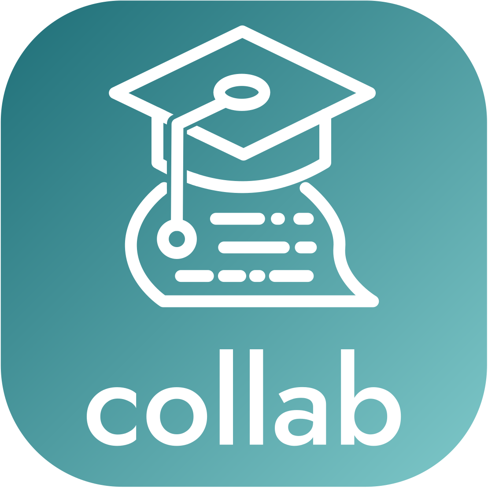

# collab.prompting.schule

Web platform for collaborative generative-AI teaching and learning settings.
Teachers create a protected **CollabSpace** with a task, a system prompt and an
OpenAI-compatible LLM endpoint; participants join with Space ID and access code,
start their own **CollabChats**, rate them, and – once rated – can see and discuss
each other's prompting approaches.

- Hosted at [collab.prompting.schule](https://collab.prompting.schule)
- Software by the [Ed-Tech Research Community Graz](https://ed-tech.at)
- Feature overview (German): [MARKETING.md](./MARKETING.md)

## Publication

The design and evaluation of this platform were [presented](https://doi.org/10.3217/jptcm-y6015) at [ICL2026](https://www.icl-conference.org/current/),
the 29th International Conference on Interactive Collaborative Learning

> Brünner, B., Nestler, M., & Ebner, M. (2026). *Experiencing AI Together: A
> Design-Based Research Approach to Collaborative Prompting in Education.*
> Presented at the 29th International Conference on Interactive Collaborative
> Learning (ICL2026). *Lecture Notes in Networks and Systems*. Springer, Cham (in press).

Authors: 

- Benedikt Brünner ([ORCID 0009-0005-8484-9160](https://orcid.org/0009-0005-8484-9160)) – Institute of Human-Centred Computing, Graz University of Technology
- Michael Nestler ([ORCID 0009-0005-5066-4942](https://orcid.org/0009-0005-5066-4942)) – Computer Science and Artificial Intelligence, FH JOANNEUM University of Applied Sciences
- Martin Ebner ([ORCID 0000-0001-5789-5296](https://orcid.org/0000-0001-5789-5296)) – Educational Technology, Graz University of Technology

If you use this software in research, please cite the publication above.

## License

- **Software:** [BSD 3-Clause License](./LICENSE)
- **Content:** [CC BY 4.0](https://creativecommons.org/licenses/by/4.0/) [FLAAIT](https://flaait.tugraz.at), Lehr- und Lerntechnologien, TU Graz

### Distribution & Self-Hosting
Self-hosting, modification, and redistribution of this project are permitted under
the applicable licenses. When self-hosting, all TU Graz–specific references,
including the TU Graz logo and institutional imprint, must be removed unless
explicit permission has been granted. 

Per the [BSD 3-Clause License](./LICENSE), the copyright
notice, list of conditions and disclaimer must be retained, and the names of the
copyright holders may not be used to endorse derived products without permission.

Content is licensed under [CC BY 4.0](https://creativecommons.org/licenses/by/4.0/)
and requires appropriate attribution to [FLAAIT](https://flaait.tugraz.at), Lehr- und
Lerntechnologien, TU Graz, including a link to [the license](https://creativecommons.org/licenses/by/4.0/) and an indication of changes.

## Tech Stack

- [SvelteKit](https://svelte.dev/docs/kit) (Svelte 5, TypeScript, `adapter-node`)
- [Prisma](https://www.prisma.io/) with PostgreSQL
- [OpenAI Node SDK](https://github.com/openai/openai-node) for any OpenAI-compatible Chat Completions API
- Markdown (`marked`) and math rendering (`KaTeX`)

### Repository Structure

```
docker/pgvector/      local PostgreSQL + pgAdmin
sveltekit/prisma/     data model and migrations
sveltekit/src/        app code (lib/, routes/)
sveltekit/static/     logos, favicons, fonts
```

# Local Development

Requirements: [Docker](https://www.docker.com/get-started/) and [Node.js](https://nodejs.org/en/download)

## 1. Start PostgreSQL

The compose file [docker/pgvector/docker-compose.yml](./docker/pgvector/docker-compose.yml)
starts PostgreSQL on port **5434** and pgAdmin on http://localhost:8080.

```bash
cd docker/pgvector
docker compose up -d
```

## 2. Create database user and databases

Connect to the server (e.g. via pgAdmin or `psql -h localhost -p 5434 -U pguser mypgdb`;
default credentials are in the compose file) and run:

```sql
CREATE USER collab_prompting_schule_dev WITH PASSWORD 'PASSWORT_NOGIT';

-- application database
CREATE DATABASE collab_prompting_schule_dev OWNER collab_prompting_schule_dev;
GRANT ALL PRIVILEGES ON DATABASE collab_prompting_schule_dev TO collab_prompting_schule_dev;

-- shadow database for prisma migrate dev
CREATE DATABASE collab_prompting_schule_dev_mig OWNER collab_prompting_schule_dev;
GRANT ALL PRIVILEGES ON DATABASE collab_prompting_schule_dev_mig TO collab_prompting_schule_dev;
```

## 3. Configure environment

```bash
cd sveltekit
cp .env.example .env
```

Adjust `DATABASE_URL` / `SHADOW_DATABASE_URL` to your password and set a random
`SESSION_JWT_SECRET`. `SUBFOLDER` sets the base path (default `collab`), and
`BODY_SIZE_LIMIT` must be raised for image uploads (default `10M`).

## 4. Install dependencies and apply migrations

```bash
cd sveltekit
npm ci
npx prisma migrate deploy
npx prisma generate
```

When changing [schema.prisma](./sveltekit/prisma/schema.prisma), create a new migration with:

```bash
npx prisma migrate dev --name <migration_name>
```

## 5. Run the dev server

```bash
cd sveltekit
npm run dev
```

Then open http://localhost:5173/collab/ (or the path configured in `SUBFOLDER`).

Optional: browse the database with Prisma Studio (`npx prisma studio`) or pgAdmin
at http://localhost:8080.

## Production Build

```bash
cd sveltekit
npm run build
node --env-file=.env build
```

The same environment variables as above are required; run `npx prisma migrate deploy`
before starting a new version.

## AI Disclaimer

Claude (Anthropic; via Claude Code) and Codex (OpenAI) were used to develop the implementation.
